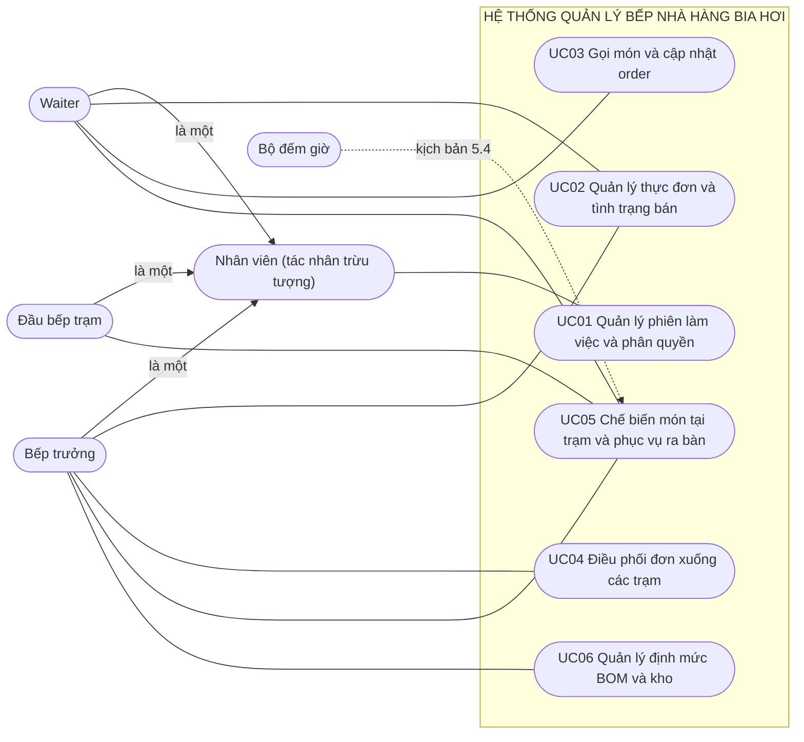
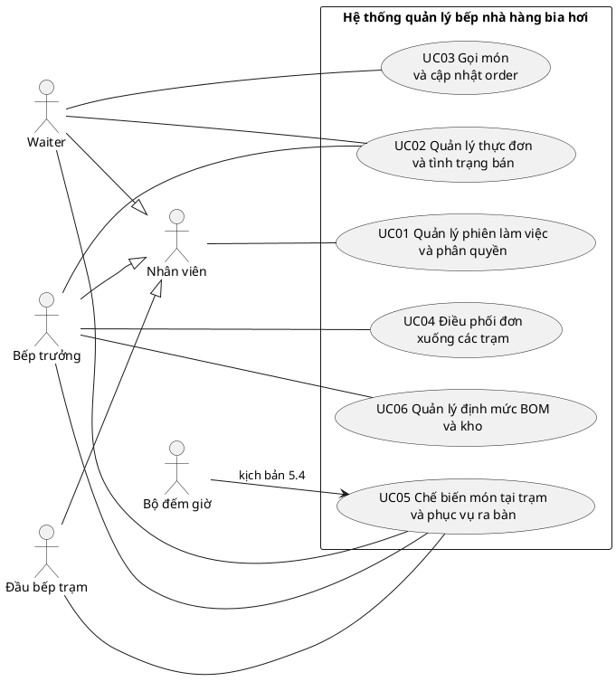
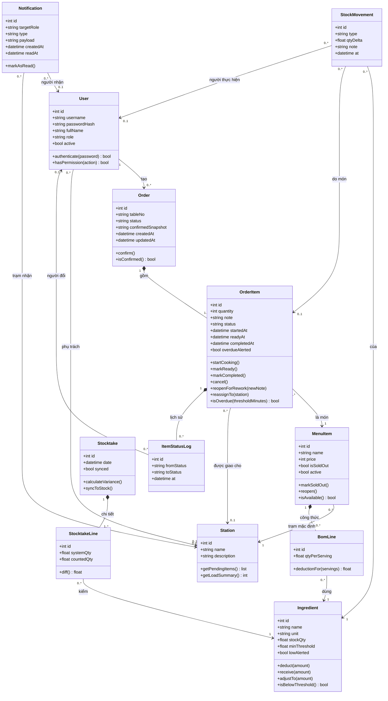
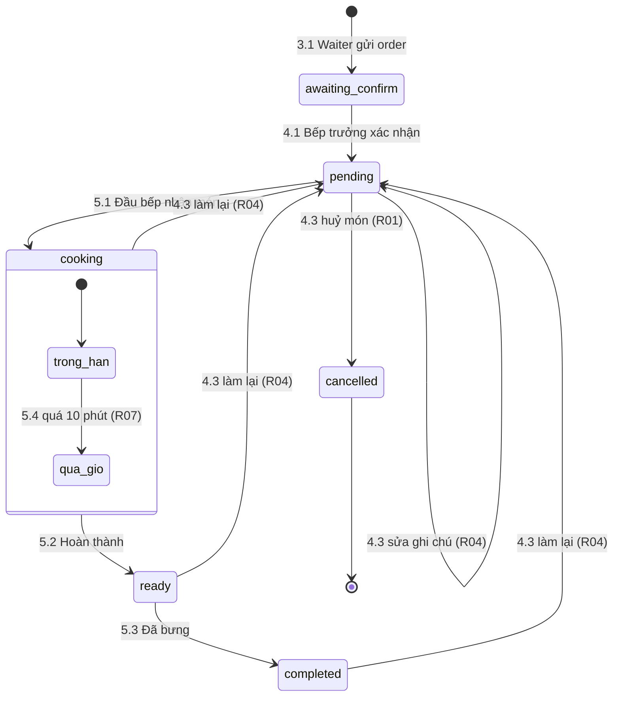
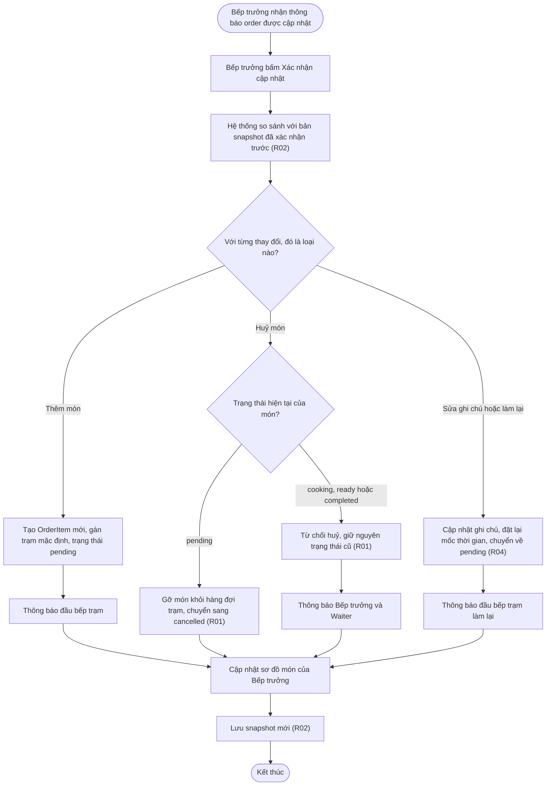
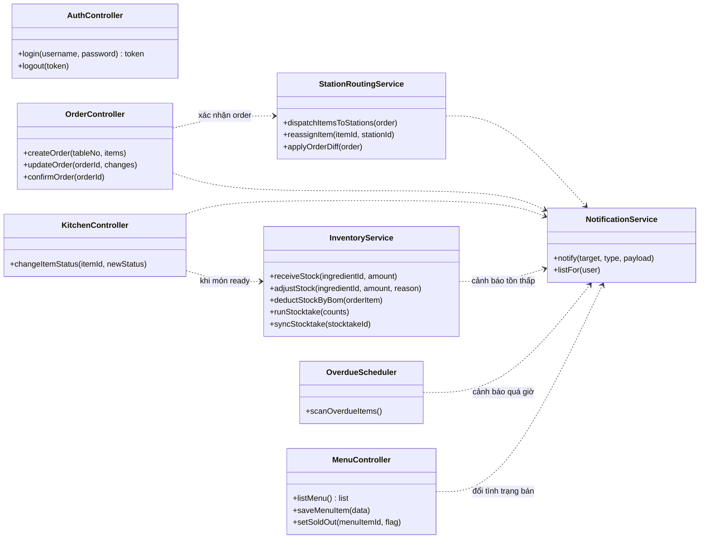
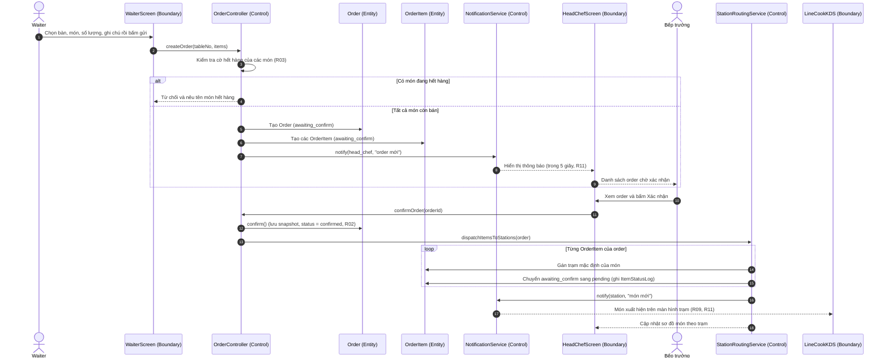
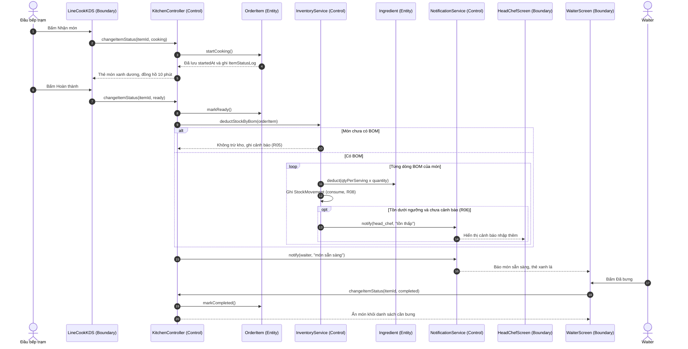
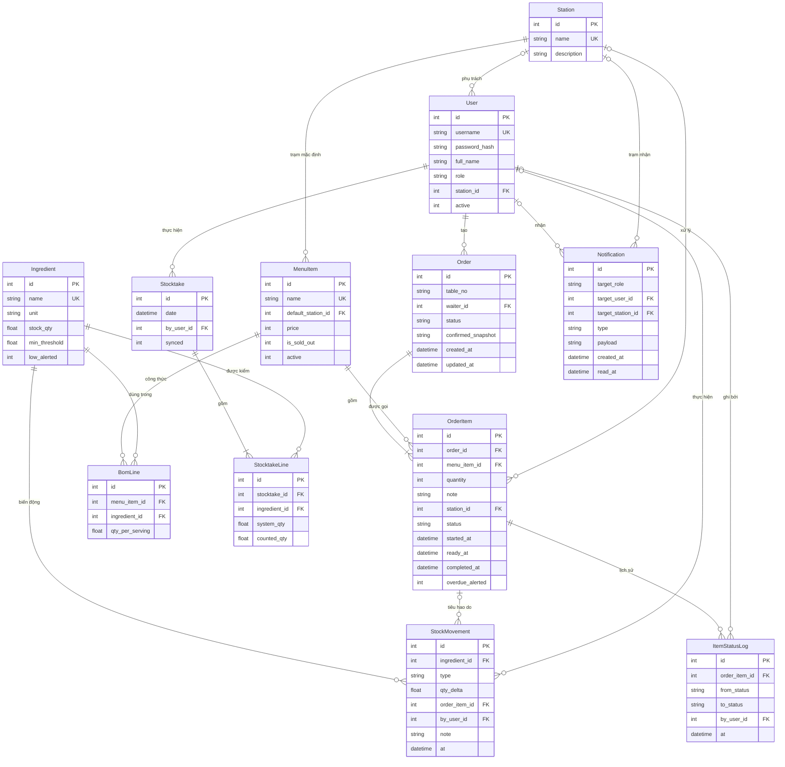

# TÀI LIỆU PHÂN TÍCH VÀ THIẾT KẾ HỆ THỐNG THEO HƯỚNG ĐỐI TƯỢNG (OOAD/UML)

## Đề tài: Hệ thống Quản lý Bếp ở Nhà hàng Bia Hơi

### Môn học: Quản trị dự án Công nghệ Thông tin - Nhóm 13

**Phiên bản 6.** Tài liệu mô tả phạm vi, tác nhân, use case, quy tắc nghiệp vụ, mô hình phân tích, thiết kế và màn hình của hệ thống.

---

# PHẦN I: TỔNG QUAN

## 1. Mục tiêu và phương pháp

Hệ thống giúp nhà hàng bia hơi điều phối món ăn từ lúc Waiter gọi món đến lúc món ra bàn, theo dõi tiến độ chế biến tại từng trạm bếp, và quản lý nguyên liệu theo định mức.

Hệ thống được phân tích và thiết kế theo hướng đối tượng với UML, theo thứ tự các phần của tài liệu:

1. **Tổng quan** (Phần I): mục tiêu, phạm vi, công nghệ.
2. **Tác nhân và use case** (Phần II): ai dùng hệ thống để làm gì.
3. **Đặc tả chi tiết các use case** (Phần III).
4. **Quy tắc nghiệp vụ, giả định và yêu cầu phi chức năng** (Phần IV).
5. **Mô hình hoá phân tích** (Phần V): sơ đồ lớp miền, sơ đồ trạng thái, sơ đồ hoạt động.
6. **Thiết kế** (Phần VI): màn hình, lớp điều khiển, sơ đồ tuần tự, mô hình dữ liệu.

## 2. Phạm vi

**Trong phạm vi:** 6 use case ở Phần III (đăng nhập, thực đơn và tình trạng bán, gọi món, điều phối trạm, chế biến và ra bàn, định mức BOM và kho).

**Ngoài phạm vi:**

- Tích hợp máy POS hoặc phần mềm bán hàng bên ngoài (Waiter nhập order trực tiếp trên hệ thống này).
- Thanh toán, đặt bàn, báo cáo doanh thu.
- Màn hình quản lý tài khoản nhân viên và danh sách bàn .
- Nhiều chi nhánh, ứng dụng di động riêng (hệ thống chạy trên trình duyệt của tablet và máy tính).

## 3. Công nghệ sử dụng

- **Backend:** Python, FastAPI; giao tiếp REST/JSON.
- **CSDL:** SQLite, bật chế độ WAL và khoá ngoại. Các tên bảng trùng từ khoá SQL (`"User"`, `"Order"`) phải đặt trong dấu nháy kép.
- **Frontend:** React (Vite) chạy trên trình duyệt.
- **Thông báo gần thời gian thực:** hỏi định kỳ (polling) 2 đến 3 giây; có thể thay bằng WebSocket hoặc SSE mà không đổi giao diện hàm.
- **Mã nguồn:** quản lý bằng Git, mỗi đầu việc một nhánh, gộp qua pull request.

## 4. Quy ước

- Giá trị trạng thái viết chữ thường, ví dụ `awaiting_confirm`, `pending`, `cooking`, `ready`, `completed`, `cancelled`.
- Mã kịch bản `1.1` đến `6.8` định nghĩa ở Phần III; quy tắc `R01` đến `R11`, giả định `A1` đến `A6`, yêu cầu phi chức năng `NFR-01` đến `NFR-08` định nghĩa ở Phần IV; màn hình `MH-xx` định nghĩa ở Phần VI.

---

# PHẦN II: TÁC NHÂN VÀ USE CASE

*Các sơ đồ trong tài liệu dùng cú pháp **Mermaid** (hiển thị trực tiếp trên GitHub, VS Code, Notion). Mermaid không có sơ đồ use case nên sơ đồ use case có thêm bản PlantUML đúng chuẩn UML.*

## 1. Tác nhân

| Tác nhân                               | Vai trò                                                                          | Ghi chú                                                                                                                            |
| ---------------------------------------- | --------------------------------------------------------------------------------- | ----------------------------------------------------------------------------------------------------------------------------------- |
| **Nhân viên**                    | Tác nhân trừu tượng, đại diện cho mọi người dùng đã có tài khoản | Quan hệ **kế thừa**: Waiter, Bếp trưởng, Đầu bếp trạm đều là một Nhân viên (cùng đăng nhập, đăng xuất) |
| **Waiter** (Nhân viên phục vụ) | Gọi món, cập nhật order, bưng món ra bàn                                   |                                                                                                                                     |
| **Bếp trưởng** (Head Chef)      | Quản lý thực đơn, điều phối trạm, quản lý kho và định mức          |                                                                                                                                     |
| **Đầu bếp trạm** (Line Cook)   | Nhận món, báo hoàn thành tại trạm của mình                               |                                                                                                                                     |
| **Bộ đếm giờ**                 | Tác nhân thời gian, chỉ kích hoạt kịch bản `5.4` (cảnh báo quá giờ) |                                                                                                                                     |

"Hệ thống" **không** là tác nhân vì nó nằm trong ranh giới hệ thống. Các hành vi tự động `6.5` (trừ kho) và `6.6` (cảnh báo tồn thấp) là **quy tắc nghiệp vụ ngầm** kích hoạt khi món chuyển sang `ready`, không có tác nhân khởi xướng riêng.

## 2. Sơ đồ use case tổng quan

**Mục đích:** chốt phạm vi hệ thống, ai dùng hệ thống để làm gì. **Cách đọc:** mỗi tác nhân nối với use case mà họ tham gia; tác nhân không nối trực tiếp với nhau (tương tác giữa các tác nhân thể hiện ở sơ đồ tuần tự và sơ đồ hoạt động). Chỉ có quan hệ kế thừa giữa các tác nhân: Waiter, Bếp trưởng, Đầu bếp đều là một Nhân viên.

Ghi chú về các đường nối: `Waiter` nối `UC02` vì xem thực đơn và thấy món bị khoá khi hết hàng; `Bếp trưởng` nối `UC05` vì nhận cảnh báo quá giờ; `Waiter` nối `UC05` vì xác nhận đã bưng món (kịch bản `5.3`).

Bản PlantUML (đúng ký hiệu UML, dán vào plantuml.com hoặc dùng tiện ích PlantUML trong VS Code)

## 3. Use case và kịch bản

Chức năng được mô tả ở hai tầng:

| Tầng | Nội dung                                          | Số lượng | Ghi chú                                                                                                     |
| ----- | -------------------------------------------------- | ----------- | ------------------------------------------------------------------------------------------------------------ |
| 1     | Use case mức tổng hợp (`UC01` đến `UC06`) | 6           | Mỗi use case gom các kịch bản cùng một nhóm mục tiêu nghiệp vụ                                    |
| 2     | Kịch bản (mã `1.1` đến `6.8`)             | 22          | Mỗi kịch bản do **đúng một tác nhân khởi xướng** (hoặc là quy tắc ngầm của hệ thống) |

Các kịch bản được mô tả trong đặc tả từng use case ở Phần III. Kịch bản `n.m` thuộc use case `UC0n` (ví dụ `2.2` Báo hết món thuộc `UC02`, `6.5` Trừ kho tự động thuộc `UC06`).

---

# PHẦN III: ĐẶC TẢ CHI TIẾT 06 USE CASE

Mỗi kịch bản (`1.1`, `1.2`, ...) có đúng một tác nhân khởi xướng (trừ các quy tắc ngầm của hệ thống). Quy tắc (`Rxx`) và giả định (`Axx`) được định nghĩa ở Phần IV; màn hình ứng với từng kịch bản xem Phần VI, mục 1.

---

### UC01: QUẢN LÝ PHIÊN LÀM VIỆC VÀ PHÂN QUYỀN TRUY CẬP

- **Mã Use Case**: `UC01`
- **Tác nhân chính**: Nhân viên (Waiter, Bếp trưởng, Đầu bếp trạm).
- **Mục tiêu nghiệp vụ**: Xác thực nhân viên, đưa họ vào đúng không gian làm việc theo vai trò, và kết thúc phiên làm việc an toàn.
- **Tiền điều kiện**:
  - Tài khoản đã được kích hoạt (`active = 1`).
  - Thiết bị kết nối được với máy chủ.
- **Hậu điều kiện**:
  - Thành công: nhân viên có phiên làm việc hợp lệ và thấy đúng màn hình theo vai trò.
  - Thất bại: bị từ chối, không lộ thông tin nhạy cảm.
- **Luồng chính (kịch bản 1.1 Đăng nhập)**:
  1. Nhân viên nhập tên đăng nhập và mật khẩu.
  2. Hệ thống tìm tài khoản, băm mật khẩu nhập vào và so khớp với `password_hash` (R10).
  3. Hệ thống tạo phiên làm việc, xác định vai trò và trạm phụ trách (nếu là đầu bếp).
  4. Hệ thống chuyển tới màn hình đúng vai trò: Waiter → màn hình tạo order, Bếp trưởng → màn hình order chờ xác nhận, Đầu bếp → màn hình của trạm mình.
- **Luồng thay thế**:
  - **2a. Sai tên đăng nhập hoặc mật khẩu**: hiển thị lỗi chung, không nói tài khoản có tồn tại hay không.
  - **2b. Tài khoản bị vô hiệu hoá**: từ chối đăng nhập kèm thông báo tạm khoá.
  - **Kịch bản 1.2 Đăng xuất** (do nhân viên khởi xướng): hệ thống huỷ phiên, về trang chủ; nút Back của trình duyệt không vào lại được trang cần đăng nhập.
- **Quy tắc áp dụng**: R10; NFR-02.

---

### UC02: QUẢN LÝ THỰC ĐƠN VÀ TÌNH TRẠNG BÁN

- **Mã Use Case**: `UC02`
- **Tác nhân chính**: Bếp trưởng. **Tác nhân tham gia**: Waiter (xem thực đơn, thấy món bị khoá khi hết hàng).
- **Mục tiêu nghiệp vụ**: Duy trì danh mục món, gán trạm mặc định cho từng món, và báo hết / mở bán lại món để Waiter không nhận món bếp không làm được.
- **Tiền điều kiện**: Bếp trưởng đã đăng nhập.
- **Hậu điều kiện**: Danh mục và cờ `is_sold_out` được cập nhật; các màn hình Waiter nhận thay đổi trong 5 giây (R11).
- **Luồng chính (kịch bản 2.1 Nhập thực đơn)**:
  1. Bếp trưởng mở màn hình quản lý thực đơn.
  2. Hệ thống hiển thị danh sách món: tên, giá, trạm mặc định, tình trạng bán.
  3. Bếp trưởng thêm món mới (tên, trạm mặc định, giá) hoặc sửa / ẩn món hiện có.
  4. Bếp trưởng bấm Lưu; hệ thống kiểm tra dữ liệu (bắt buộc có trạm mặc định, tên không trùng) và ghi nhận.
- **Luồng thay thế**:
  - **Kịch bản 2.2 Báo hết món** (R03): Bếp trưởng chọn món và bấm "Hết hàng"; hệ thống đặt `is_sold_out = 1` và thông báo cho các màn hình Waiter. Món bị khoá, làm mờ, không chọn được. Các order đã xác nhận trước đó không bị ảnh hưởng.
  - **Kịch bản 2.3 Mở bán lại món**: Bếp trưởng bấm "Mở lại món"; hệ thống đặt `is_sold_out = 0` và mở khoá món trên màn hình Waiter.
- **Quy tắc áp dụng**: R03, R10, R11.

---

### UC03: GỌI MÓN VÀ CẬP NHẬT ORDER TẠI BÀN

- **Mã Use Case**: `UC03`
- **Tác nhân chính**: Waiter.
- **Mục tiêu nghiệp vụ**: Ghi nhận chính xác món khách gọi theo từng bàn (số lượng, ghi chú), gửi về Bếp trưởng xác nhận, và hỗ trợ gọi thêm hoặc điều chỉnh sau đó.
- **Tiền điều kiện**: Waiter đã đăng nhập; thực đơn đang hoạt động.
- **Hậu điều kiện**: Order ở trạng thái `awaiting_confirm`, các dòng món ở trạng thái `awaiting_confirm`; Bếp trưởng nhận thông báo trong 5 giây (R11).
- **Luồng chính (kịch bản 3.1 Tạo order)**:
  1. Waiter chọn bàn.
  2. Hệ thống hiển thị thực đơn kèm tình trạng bán.
  3. Waiter chọn món, số lượng (ví dụ: 2 Ca bia Hà Nội, 1 Đậu lướt ván, 1 Chân gà nướng).
  4. Waiter nhập ghi chú cho từng món nếu có (ví dụ: "làm giòn cháy cạnh", "ít cay").
  5. Waiter xem lại giỏ món và bấm "Xác nhận gửi đơn".
  6. Hệ thống kiểm tra cờ hết hàng của tất cả món (R03), tạo `Order` (`awaiting_confirm`) và các `OrderItem` (`awaiting_confirm`).
  7. Hệ thống gửi thông báo tới Bếp trưởng.
- **Luồng thay thế**:
  - **6a. Có món vừa hết hàng**: hệ thống từ chối tạo order, nêu tên món hết hàng và đánh dấu món đó trong giỏ để Waiter chỉnh lại.
  - **Kịch bản 3.2 Cập nhật order**: Waiter mở lại order của bàn, thêm món, đánh dấu huỷ món hoặc sửa ghi chú, rồi gửi cập nhật. Nếu order còn `awaiting_confirm`, bản mới ghi đè bản đang chờ (A2). Nếu order đã xác nhận, hệ thống lưu thay đổi, tạo order tổng mới và thông báo Bếp trưởng xử lý theo kịch bản `4.3`. Việc huỷ món chỉ đánh dấu yêu cầu huỷ; việc huỷ thật do Bếp trưởng xác nhận.
- **Quy tắc áp dụng**: R02, R03, R11; giả định A2.

---

### UC04: ĐIỀU PHỐI ĐƠN XUỐNG CÁC TRẠM BẾP

- **Mã Use Case**: `UC04`
- **Tác nhân chính**: Bếp trưởng.
- **Mục tiêu nghiệp vụ**: Kiểm soát order đi vào bếp, để hệ thống tách món về đúng trạm, điều chuyển khi trạm quá tải, và xử lý các yêu cầu điều chỉnh, huỷ, làm lại từ Waiter.
- **Tiền điều kiện**: Bếp trưởng đã đăng nhập; có order ở trạng thái `awaiting_confirm`.
- **Hậu điều kiện**: Order `confirmed` kèm snapshot (R02); các món `pending` xuất hiện trên màn hình của trạm trong 5 giây (R11).
- **Luồng chính (kịch bản 4.1 Điều phối tự động)**:
  1. Bếp trưởng nhận thông báo có order mới (có thể kèm âm báo).
  2. Bếp trưởng mở order, xem món, số lượng, ghi chú và trạm mặc định.
  3. Bếp trưởng bấm "Xác nhận".
  4. Hệ thống:
     - lưu snapshot của order (R02);
     - đặt `Order.status = confirmed`;
     - gán trạm mặc định cho từng `OrderItem` và chuyển từ `awaiting_confirm` sang `pending`, ghi lịch sử trạng thái. Xác nhận lặp không tạo món trùng.
  5. Hệ thống đẩy món xuống màn hình của từng trạm (ví dụ các trạm: Nướng, Chiên, Xào, Món lạnh) và cập nhật sơ đồ món theo trạm cho Bếp trưởng.
- **Luồng thay thế**:
  - **Kịch bản 4.2 Điều phối thủ công**: Khi một trạm quá tải, Bếp trưởng chọn món và trạm đích trên sơ đồ (kéo-thả là phần nâng cấp), rồi bấm "Xác nhận điều chỉnh". Hệ thống đổi trạm cho món, gỡ món khỏi hàng đợi trạm cũ và đưa sang trạm mới. **Chỉ món `pending`** được điều chuyển (R01); món khác bị từ chối kèm lý do.
  - **Kịch bản 4.3 Xử lý điều chỉnh order**: Khi Waiter gửi cập nhật cho order đã xác nhận, Bếp trưởng bấm xác nhận cập nhật, hệ thống so sánh với snapshot và xử lý từng thay đổi (xem sơ đồ hoạt động):
    - *Thêm món*: tạo dòng món mới, gán trạm mặc định, trạng thái `pending`.
    - *Huỷ món* (R01): món `pending` thì được huỷ (`cancelled`, gỡ khỏi trạm); món `cooking`, `ready` hoặc `completed` thì **bị từ chối huỷ**, giữ nguyên trạng thái và thông báo Bếp trưởng và Waiter.
    - *Sửa ghi chú / làm lại* (R04): cập nhật ghi chú, đặt lại mốc thời gian, chuyển món về `pending` (kể cả khi đang `cooking`, `ready` hoặc `completed`), giữ nguyên dòng món, thông báo đầu bếp trạm.
    - Sau khi xử lý, hệ thống lưu snapshot mới (R02).
- **Quy tắc áp dụng**: R01, R02, R04, R11; giả định A1.

---

### UC05: CHẾ BIẾN MÓN TẠI TRẠM VÀ PHỤC VỤ RA BÀN

- **Mã Use Case**: `UC05`
- **Tác nhân chính**: Đầu bếp trạm. **Tác nhân tham gia**: Waiter (kịch bản `5.3`), Bếp trưởng (nhận cảnh báo quá giờ), Bộ đếm giờ (kích hoạt kịch bản `5.4`).
- **Mục tiêu nghiệp vụ**: Đầu bếp làm món theo thứ tự gửi đến (vào trước làm trước), kiểm soát thời gian nấu, và báo ngay khi món sẵn sàng để Waiter mang ra.
- **Tiền điều kiện**: Đầu bếp đã đăng nhập vào trạm của mình; có món `pending` ở trạm.
- **Hậu điều kiện**: Món chuyển `completed` khi đã lên bàn; kho đã trừ theo BOM; mọi chuyển trạng thái được ghi lịch sử.
- **Luồng chính**:
  1. Đầu bếp xem danh sách món của trạm, sắp xếp theo thời gian gửi tăng dần (R09).
  2. **Kịch bản 5.1**: Đầu bếp bấm "Nhận món". Hệ thống chuyển `pending` → `cooking`, lưu `started_at`, thẻ món màu xanh dương, bắt đầu đếm ngược 10 phút (A5).
  3. **Kịch bản 5.2**: Khi nấu xong, Đầu bếp bấm "Hoàn thành". Hệ thống chuyển `cooking` → `ready`, lưu `ready_at`, thẻ món màu xanh lá, thực hiện quy tắc trừ kho (kịch bản `6.5`, R05) và thông báo Waiter của bàn.
  4. **Kịch bản 5.3** (Waiter khởi xướng): Waiter mang món ra bàn rồi bấm "Đã bưng". Hệ thống chuyển `ready` → `completed`, lưu `completed_at`, gỡ món khỏi danh sách cần bưng.
- **Luồng thay thế**:
  - **Kịch bản 5.4 Cảnh báo quá giờ** (Bộ đếm giờ khởi xướng, R07): bộ đếm giờ quét định kỳ. Nếu món `cooking` quá 10 phút, hệ thống làm nổi thẻ món trên màn hình trạm, gửi cảnh báo cho đầu bếp và Bếp trưởng, đặt `overdue_alerted = 1` để mỗi món chỉ cảnh báo một lần.
  - **3a. Món chưa có BOM**: khi sang `ready` hệ thống không trừ kho, ghi cảnh báo để Bếp trưởng bổ sung BOM (R05).
- **Quy tắc áp dụng**: R05, R07, R09, R11; giả định A5.

---

### UC06: QUẢN LÝ ĐỊNH MỨC BOM VÀ KHO NGUYÊN LIỆU

- **Mã Use Case**: `UC06`
- **Tác nhân chính**: Bếp trưởng.
- **Mục tiêu nghiệp vụ**: Quản lý nguyên liệu, công thức tiêu hao (BOM) của từng món, nhập kho, trừ kho tự động khi ra món, cảnh báo tồn thấp và kiểm kê hao hụt. UC này gồm ba nhóm kịch bản, mỗi kịch bản do Bếp trưởng khởi xướng: quản lý nguyên liệu và nhập kho (`6.1`, `6.2`), công thức BOM (`6.3`, `6.4`), kiểm kê (`6.7`, `6.8`). Các kịch bản `6.5` và `6.6` là quy tắc ngầm.
- **Tiền điều kiện**: Bếp trưởng đã đăng nhập.
- **Hậu điều kiện**: Số tồn phản ánh đúng lượng tiêu hao thực tế; mọi biến động kho có dòng lịch sử (R08).
- **Luồng chính**: Bếp trưởng vào phân hệ "Kho và định mức" và chọn một trong các kịch bản sau.
  - **Danh mục nguyên liệu**: thêm/sửa nguyên liệu với tên, đơn vị, ngưỡng tồn tối thiểu.
  - **6.1 Nhập kho**: chọn nguyên liệu, nhập số lượng. Hệ thống cộng vào `stock_qty`, lưu thời gian và người nhập, ghi lịch sử loại `import`.
  - **6.2 Điều chỉnh kho**: sửa số tồn thủ công kèm lý do (ví dụ nhập sai, hỏng hàng). Hệ thống ghi lịch sử loại `adjust`.
  - **6.3 Khai báo BOM**: chọn món, thêm các nguyên liệu với định lượng cho 1 suất (ví dụ 1 Ca bia 2L = 2 lít bia keg; 1 Đĩa bò xào = 0,25 kg thịt bò). Mỗi món có một công thức.
  - **6.4 Cập nhật BOM**: sửa, thêm hoặc xoá dòng định lượng; thay đổi chỉ áp dụng cho các lần trừ kho sau.
  - **6.7 Kiểm kê**: cuối ngày, Bếp trưởng nhập số thực tế từng nguyên liệu và bấm "Tính toán chênh lệch"; hệ thống đối chiếu với số tồn trên phần mềm và hiển thị bảng chênh lệch.
  - **6.8 Đồng bộ hàng tồn**: Bếp trưởng bấm "Đồng bộ"; hệ thống cập nhật tồn theo số thực tế và ghi lịch sử loại `stocktake`. Mỗi phiên kiểm kê chỉ đồng bộ một lần.
- **Quy tắc nghiệp vụ ngầm (không có tác nhân khởi xướng)**:
  - **6.5 Trừ kho khi món `ready`** (R05): với mỗi món chuyển sang `ready`, hệ thống tra công thức BOM của món, lượng trừ = định lượng × số lượng, trừ vào `stock_qty` trong một giao dịch và ghi lịch sử loại `consume` gắn với dòng món. Cho phép tồn âm và cảnh báo. Món làm lại (về `pending` rồi `ready` lần nữa) bị trừ thêm một lần (R04).
  - **6.6 Cảnh báo tồn dưới ngưỡng** (R06): sau mỗi lần trừ, nếu `stock_qty < min_threshold` và `low_alerted = 0` thì thông báo Bếp trưởng cần nhập thêm và đặt `low_alerted = 1`. Khi nhập kho (`6.1`), điều chỉnh (`6.2`) hoặc đồng bộ (`6.8`) làm tồn lên lại bằng hoặc hơn ngưỡng thì đặt lại `low_alerted = 0`.
- **Quy tắc áp dụng**: R05, R06, R08; giả định A3.

---

# PHẦN IV: QUY TẮC NGHIỆP VỤ, GIẢ ĐỊNH VÀ YÊU CẦU PHI CHỨC NĂNG

## 1. Quy tắc nghiệp vụ

| Mã           | Quy tắc                                                                                                                                                                                                                                                                                         | Kịch bản liên quan   |
| ------------- | ------------------------------------------------------------------------------------------------------------------------------------------------------------------------------------------------------------------------------------------------------------------------------------------------ | ----------------------- |
| **R01** | Chỉ món `pending` mới được huỷ hoặc điều chuyển sang trạm khác. Món `cooking`, `ready`, `completed` bị từ chối huỷ.                                                                                                                                                    | 4.2, 4.3                |
| **R02** | Mỗi bản order chỉ tách xuống trạm đúng một lần (xác nhận lặp không tạo món trùng). Khi Bếp trưởng xác nhận, hệ thống lưu bản snapshot của order để so sánh với lần Waiter cập nhật sau.                                                                        | 3.2, 4.1, 4.3           |
| **R03** | Món đang `hết hàng` không chọn được khi tạo order hoặc cập nhật order; hệ thống kiểm tra lại lúc gửi. Order đã xác nhận không bị ảnh hưởng khi món hết hàng.                                                                                                    | 2.2, 3.1, 3.2           |
| **R04** | Điều chỉnh / làm lại món: món chuyển về `pending` với ghi chú mới (kể cả khi đang `cooking`, `ready`, `completed`), giữ nguyên dòng món, không tạo dòng mới. Mỗi lần món sang `ready` là một lần trừ kho.                                                | 4.3, 6.5                |
| **R05** | Trừ kho khi món sang `ready`: lượng trừ = định lượng BOM × số lượng, thực hiện trong một giao dịch CSDL. Món chưa có BOM thì không trừ và ghi cảnh báo. Cho phép tồn âm và cảnh báo.                                                                           | 5.2, 6.5                |
| **R06** | Cảnh báo tồn dưới ngưỡng chỉ gửi một lần, cho tới khi tồn lên lại bằng hoặc hơn ngưỡng thì mới được cảnh báo tiếp.                                                                                                                                                   | 6.6                     |
| **R07** | Cảnh báo quá giờ khi món `cooking` quá 10 phút, mỗi món một lần; mốc 10 phút là hằng số cấu hình được.                                                                                                                                                                    | 5.4                     |
| **R08** | Mọi thay đổi tồn kho (nhập, tiêu hao, điều chỉnh, kiểm kê) đều ghi một dòng vào lịch sử biến động kho.                                                                                                                                                                      | 6.1, 6.2, 6.5, 6.8      |
| **R09** | Danh sách món ở trạm sắp xếp theo thời gian gửi, món gửi sớm nhất ở trên cùng.                                                                                                                                                                                                    | 5.1                     |
| **R10** | Phân quyền theo vai trò: Waiter (kịch bản 3.1, 3.2, 5.3 và xem thực đơn), Bếp trưởng (kịch bản 2.x, 4.x, 6.x), Đầu bếp trạm (kịch bản 5.1, 5.2). Cảnh báo quá giờ (5.4) gửi tới đầu bếp của trạm và Bếp trưởng. Mật khẩu lưu dạng băm, không lưu thô. | Tất cả                |
| **R11** | Thông báo và cập nhật màn hình tới người nhận trong vòng 5 giây.                                                                                                                                                                                                                    | 2.2, 2.3, 3.1, 4.1, 5.x |

## 2. Giả định đã chốt

| Mã          | Giả định                                                                                                                                            |
| ------------ | ------------------------------------------------------------------------------------------------------------------------------------------------------ |
| **A1** | Bếp trưởng chỉ xác nhận order tổng, không có thao tác từ chối order.                                                                       |
| **A2** | Waiter sửa order khi order còn `awaiting_confirm` thì bản mới ghi đè bản đang chờ; Bếp trưởng chỉ thấy bản mới nhất.               |
| **A3** | Một dòng món có số lượng từ 1 trở lên chỉ có một trạng thái chung; trừ kho nhân với số lượng.                                     |
| **A4** | Thực đơn có trường giá (tùy chọn), không dùng trong luồng bếp.                                                                            |
| **A5** | Đồng hồ "đếm ngược" ở kịch bản `5.1` đếm từ 10 phút; hết giờ thì món thành quá giờ (kịch bản `5.4`).                        |
| **A6** | Tài khoản nhân viên, danh sách bàn và việc gán đầu bếp vào trạm được nạp sẵn bằng dữ liệu mẫu, không có màn hình quản lý. |

## 3. Yêu cầu phi chức năng

| Mã              | Yêu cầu                                                                                                                                                                                           |
| ---------------- | --------------------------------------------------------------------------------------------------------------------------------------------------------------------------------------------------- |
| **NFR-01** | Hiệu năng: thông báo và cập nhật màn hình đến người nhận trong 5 giây, không cần tải lại trang (R11).                                                                            |
| **NFR-02** | Bảo mật: mật khẩu băm; phiên làm việc có hạn dùng; mọi API kiểm tra vai trò, sai quyền trả lỗi 403; thông báo lỗi đăng nhập không lộ tài khoản có tồn tại hay không. |
| **NFR-03** | Đồng thời: nhiều màn hình (Waiter, Bếp trưởng, các trạm) cùng đọc và ghi SQLite ở chế độ WAL; các giao dịch ghi ngắn (ví dụ trừ kho cả món trong một giao dịch).       |
| **NFR-04** | Thiết bị: giao diện dùng được trên tablet cảm ứng, nút và chữ đủ lớn.                                                                                                               |
| **NFR-05** | Toàn vẹn dữ liệu: giá trị trạng thái bị ràng buộc ở mức CSDL; mọi lần đổi trạng thái của món và mọi biến động kho đều có lịch sử.                                    |
| **NFR-06** | Bảo trì: mọi thay đổi trạng thái của món đi qua đúng một nơi (máy trạng thái); mỗi quy tắc nghiệp vụ chỉ được viết ở một nơi.                                          |
| **NFR-07** | Chịu lỗi mạng: màn hình mất kết nối thì tự kết nối lại và tải lại dữ liệu mới.                                                                                                   |
| **NFR-08** | Triển khai: cài đặt và chạy được từ đầu trên máy mới theo một tài liệu hướng dẫn ngắn; có dữ liệu mẫu để chạy thử.                                                    |

---

# PHẦN V: MÔ HÌNH HOÁ PHÂN TÍCH

## 1. Sơ đồ lớp miền

**Mục đích:** cho biết hệ thống gồm những "thứ" nào, mỗi thứ giữ dữ liệu gì, có hành vi nghiệp vụ gì và liên hệ với nhau ra sao. Đây là cơ sở để ra các bảng dữ liệu và các lớp thực thể. **Cách đọc:** mỗi hộp là một lớp (thuộc tính ở trên, phương thức ở dưới); đường nối có số lượng ở hai đầu (ví dụ `1` đến `0..*` là một bên có nhiều bên kia). Đường có hình thoi đặc là hợp thành (xoá cái chứa thì mất cái được chứa). Khoá ngoại không vẽ ở đây mà ở ERD (Phần VI, mục 4).

**Giá trị hợp lệ của các thuộc tính kiểu chuỗi:**

| Thuộc tính                                                                   | Giá trị                                                                                                                                   |
| ------------------------------------------------------------------------------ | ------------------------------------------------------------------------------------------------------------------------------------------- |
| `User.role`                                                                  | `waiter`, `head_chef`, `line_cook`                                                                                                    |
| `Order.status`                                                               | `awaiting_confirm`, `confirmed`                                                                                                         |
| `OrderItem.status`, `ItemStatusLog.fromStatus`, `ItemStatusLog.toStatus` | `awaiting_confirm`, `pending`, `cooking`, `ready`, `completed`, `cancelled`                                                     |
| `StockMovement.type`                                                         | `import` (nhập), `consume` (tiêu hao), `adjust` (điều chỉnh), `stocktake` (kiểm kê)                                          |
| `Notification.type`                                                          | `order_new`, `order_updated`, `item_new`, `item_ready`, `item_overdue`, `item_cancel_rejected`, `low_stock`, `menu_changed` |

Ghi chú:

- `OrderItem` thuộc `Order` bằng quan hệ **hợp thành**. `BomLine` chỉ thuộc `MenuItem`; `Ingredient` chỉ được `BomLine` tham chiếu bằng liên kết thường (một thành phần không có hai chủ).
- Một trạm có nhiều đầu bếp: `User "0..*" → "0..1" Station` (Bếp trưởng và Waiter không thuộc trạm nào).
- `OrderItem.station` có thể trống khi món còn `awaiting_confirm`; trạm được gán khi Bếp trưởng xác nhận (kịch bản `4.1`).

## 2. Sơ đồ trạng thái của món (`OrderItem`)

**Mục đích:** quy định món đi qua những trạng thái nào, chuyển khi nào, bị cấm chuyển khi nào. Đây là cơ sở của máy trạng thái trong code. **Cách đọc:** mỗi mũi tên là một lần chuyển, nhãn gồm kịch bản gây ra và quy tắc áp dụng.

| Chuyển trạng thái                                                 | Kịch bản | Điều kiện / quy tắc                                                  | Hành động đi kèm                                                                                    |
| -------------------------------------------------------------------- | ---------- | ------------------------------------------------------------------------ | -------------------------------------------------------------------------------------------------------- |
| (tạo) → `awaiting_confirm`                                       | 3.1        | Món còn bán (R03)                                                     | Thông báo Bếp trưởng                                                                                |
| `awaiting_confirm` → `pending`                                  | 4.1        | Bếp trưởng xác nhận order; xác nhận lặp không tạo trùng (R02) | Lưu snapshot, gán trạm mặc định, ghi lịch sử, đẩy xuống màn hình trạm                      |
| `pending` → `cooking`                                           | 5.1        | Đầu bếp đúng trạm                                                  | Lưu `startedAt`, bắt đầu đếm ngược 10 phút                                                    |
| `cooking` → `ready`                                             | 5.2        |                                                                          | Lưu `readyAt`, trừ kho theo BOM (R05), thông báo Waiter                                            |
| `ready` → `completed`                                           | 5.3        |                                                                          | Lưu `completedAt`, món rời danh sách cần bưng                                                    |
| `pending` → `cancelled`                                         | 4.3        | **Chỉ món `pending`** (R01)                                    | Gỡ món khỏi hàng đợi của trạm                                                                    |
| `cooking` / `ready` / `completed` → `cancelled`             | 4.3        | **Không cho phép** (R01)                                         | Từ chối huỷ, trả về trạng thái cũ, thông báo Bếp trưởng và Waiter                          |
| `pending` / `cooking` / `ready` / `completed` → `pending` | 4.3        | Sửa ghi chú / làm lại (R04), giữ nguyên dòng món                 | Đặt lại mốc thời gian, gửi lại đầu bếp trạm; lần sau sang `ready` trừ kho thêm một lần |
| trong `cooking`: `trong_han` → `qua_gio`                      | 5.4        | Quá 10 phút, mỗi món một lần (R07)                                 | Cảnh báo đầu bếp và Bếp trưởng                                                                  |

`completed` không phải trạng thái kết thúc vì món vẫn có thể được làm lại theo R04. Chỉ `cancelled` là trạng thái kết thúc.

## 3. Sơ đồ hoạt động: xử lý điều chỉnh order (kịch bản 4.3)

**Mục đích:** mô tả các nhánh rẽ khi Bếp trưởng xác nhận một order đã bị Waiter sửa; mỗi nhánh là một nhóm ca kiểm thử. **Cách đọc:** hình thoi là điểm rẽ nhánh, hình chữ nhật là hành động, hình bo tròn là điểm bắt đầu và kết thúc.

---

# PHẦN VI: THIẾT KẾ

## 1. Danh sách màn hình

Danh sách các màn hình của hệ thống, gồm người dùng, thành phần chính và kịch bản tương ứng.

| Mã             | Màn hình                                         | Người dùng    | Thành phần chính                                                                                                                                       | Kịch bản                 |
| --------------- | -------------------------------------------------- | ---------------- | --------------------------------------------------------------------------------------------------------------------------------------------------------- | -------------------------- |
| **MH-01** | Đăng nhập                                       | Mọi nhân viên | Ô tên đăng nhập, mật khẩu, nút đăng nhập, thông báo lỗi                                                                                     | 1.1                        |
| **MH-02** | Khung điều hướng và thông báo (dùng chung) | Mọi nhân viên | Thanh trên có tên, vai trò, chuông thông báo, nút Đăng xuất; menu theo vai trò; hộp thoại xác nhận, thẻ món dùng chung                 | 1.1, 1.2, mọi thông báo |
| **MH-W1** | Waiter: Tạo order                                 | Waiter           | Chọn bàn, danh sách món (món hết bị mờ), số lượng, ghi chú từng món, giỏ món, nút Gửi                                                   | 2.2, 2.3, 3.1              |
| **MH-W2** | Waiter: Order của bàn và món cần bưng        | Waiter           | Sửa số lượng/ghi chú, thêm món, đánh dấu huỷ món, trạng thái từng món, thông báo món sẵn sàng, nút Đã bưng                       | 3.2, 5.2, 5.3              |
| **MH-B1** | Bếp trưởng: Order chờ xác nhận               | Bếp trưởng    | Danh sách order chờ (bàn, món, số lượng, ghi chú, giờ gửi), thông báo order mới, nút Xác nhận                                             | 3.1, 4.1                   |
| **MH-B2** | Bếp trưởng: Sơ đồ món theo trạm            | Bếp trưởng    | Mỗi trạm một cột, thẻ món nhóm theo bàn, màu theo trạng thái, cảnh báo quá giờ, chọn món và trạm đích, nút Xác nhận điều chỉnh | 4.1, 4.2, 5.4              |
| **MH-B3** | Bếp trưởng: Xác nhận cập nhật order         | Bếp trưởng    | Bảng khác biệt (món thêm, món huỷ, ghi chú đổi), nút Xác nhận cập nhật, kết quả xử lý kể cả món bị từ chối huỷ                  | 4.3                        |
| **MH-B4** | Bếp trưởng: Thực đơn và tình trạng bán   | Bếp trưởng    | Danh sách món, thêm/sửa/ẩn món, chọn trạm mặc định, nút Hết hàng / Mở lại món, nút Lưu                                                 | 2.1, 2.2, 2.3              |
| **MH-B5** | Bếp trưởng: Nguyên liệu và kho               | Bếp trưởng    | Danh mục nguyên liệu (tên, đơn vị, ngưỡng), nhập kho, điều chỉnh tồn kèm lý do, danh sách nguyên liệu sắp hết                        | 6.1, 6.2, 6.6              |
| **MH-B6** | Bếp trưởng: Công thức BOM                     | Bếp trưởng    | Chọn món, bảng nguyên liệu và định lượng 1 suất, thêm/sửa/xoá dòng                                                                         | 6.3, 6.4                   |
| **MH-B7** | Bếp trưởng: Kiểm kê                           | Bếp trưởng    | Nhập số thực tế từng nguyên liệu, nút Tính chênh lệch, bảng chênh lệch, nút Đồng bộ                                                     | 6.7, 6.8                   |
| **MH-K1** | Đầu bếp: Màn hình trạm                       | Đầu bếp trạm | Danh sách món của trạm theo thứ tự gửi, nút Nhận món, đồng hồ đếm ngược, nút Hoàn thành, màu trạng thái, cảnh báo quá giờ      | 5.1, 5.2, 5.4              |

## 2. Lớp điều khiển (sơ đồ lớp thiết kế theo mẫu BCE)

**Mục đích:** cho biết logic nghiệp vụ nằm ở lớp nào, để chia module backend. **Cách đọc:** Boundary là các màn hình (mục 1 của Phần này), Control là các lớp dưới đây (điều phối các bước, không giữ dữ liệu), Entity là các lớp ở Phần V, mục 1. Mũi tên đứt là "phụ thuộc, có gọi".

Quy ước chống chồng lấn: mọi thay đổi trạng thái của món đều đi qua các phương thức của `OrderItem` (`startCooking`, `markReady`, `markCompleted`, `cancel`, `reopenForRework`), các lớp điều khiển chỉ gọi, không ghi thẳng cột `status`.

**Lớp điều khiển phụ trách:**

| Lớp điều khiển                      | Kịch bản                      | Màn hình          | Quy tắc áp dụng |
| --------------------------------------- | ------------------------------- | ------------------- | ------------------ |
| `AuthController`                      | 1.1, 1.2                        | MH-01, MH-02        | R10                |
| `MenuController`                      | 2.1, 2.2, 2.3                   | MH-B4, MH-W1        | R03                |
| `OrderController`                     | 3.1, 3.2                        | MH-W1, MH-W2, MH-B1 | R02, R03           |
| `StationRoutingService`               | 4.1, 4.2, 4.3                   | MH-B1, MH-B2, MH-B3 | R01, R02, R04      |
| `KitchenController` và `OrderItem` | 5.1, 5.2, 5.3                   | MH-K1, MH-W2        | R09                |
| `OverdueScheduler`                    | 5.4                             | MH-K1, MH-B2        | R07                |
| `InventoryService`                    | 6.1 đến 6.8                   | MH-B5, MH-B6, MH-B7 | R05, R06, R08      |
| `NotificationService`                 | mọi kịch bản có thông báo | MH-02               | R11                |

## 3. Sơ đồ tuần tự

**Mục đích:** cho thấy một kịch bản chạy qua những màn hình và lớp nào theo thứ tự nào; từ đó ra API, thông điệp giữa các lớp và các chỗ cần tích hợp giữa frontend và backend. **Cách đọc:** thời gian chạy từ trên xuống; mỗi mũi tên là một lời gọi; khối `alt` là rẽ nhánh, `loop` là lặp, `opt` là bước tuỳ điều kiện.

### 3.1. Tạo order và điều phối xuống trạm (kịch bản 3.1 và 4.1)

### 3.2. Chế biến, trừ kho và bưng món (kịch bản 5.1, 5.2, 5.3, 6.5, 6.6)

## 4. Mô hình dữ liệu (ERD)

**Mục đích:** chuyển mô hình miền thành bảng CSDL, gồm khoá chính, khoá ngoại và các cột. **Cách đọc:** `PK` là khoá chính, `FK` khoá ngoại, `UK` giá trị duy nhất; ký hiệu ở hai đầu đường nối cho biết số lượng (`||` đúng một, `|o` không hoặc một, `o{` không hoặc nhiều, `|{` một hoặc nhiều).

**Ràng buộc và lưu ý khi tạo bảng SQLite:**

| Nội dung                         | Quy định                                                                                                                                                                                              |
| --------------------------------- | ------------------------------------------------------------------------------------------------------------------------------------------------------------------------------------------------------- |
| Kiểu cờ                         | SQLite không có kiểu bool, dùng `INTEGER` 0 hoặc 1 (`active`, `is_sold_out`, `overdue_alerted`, `low_alerted`, `synced`)                                                               |
| Kiểu khoá chính                | `INTEGER` tự tăng; nếu dữ liệu mẫu hiện có dùng chuỗi (ví dụ mã trạm) thì giữ nguyên kiểu đó cho thống nhất giữa các bảng                                                    |
| Ràng buộc giá trị (`CHECK`) | `User.role`, `Order.status`, `OrderItem.status`, `ItemStatusLog.from_status/to_status`, `StockMovement.type` chỉ nhận các giá trị ở bảng giá trị hợp lệ (Phần V, mục 1) (NFR-05) |
| Duy nhất                         | `BomLine (menu_item_id, ingredient_id)` không trùng; `Ingredient.name`, `MenuItem.name`, `Station.name`, `User.username` duy nhất                                                          |
| Cột có thể trống              | `User.station_id` (Bếp trưởng, Waiter), `OrderItem.station_id` (khi còn `awaiting_confirm`), `StockMovement.order_item_id` (khi không do món)                                             |
| Chỉ mục gợi ý                 | `OrderItem (station_id, status, created thứ tự gửi)` cho danh sách món của trạm (R09); `Notification (target_role, target_station_id, id)` cho truy vấn thông báo mới                    |
| Cấu hình                        | Bật `PRAGMA journal_mode=WAL` và `PRAGMA foreign_keys=ON` (NFR-03)                                                                                                                                |
| Trường tính được            | `StocktakeLine.diff` = `counted_qty` − `system_qty`, không lưu                                                                                                                                 |
| Tên bảng                        | `"User"` và `"Order"` trùng từ khoá SQL nên đặt trong dấu nháy kép                                                                                                                        |
